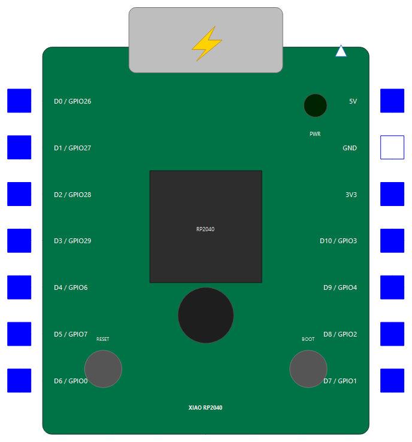
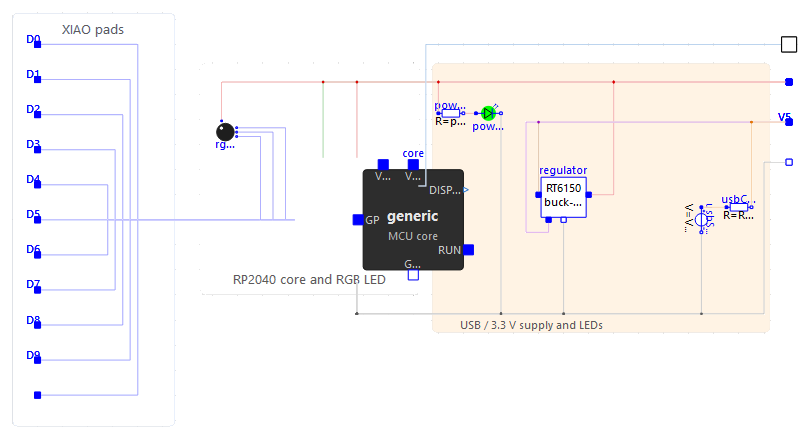

# La carte Seeed Studio XIAO RP2040

`MicroPythonMCU.XIAO_rp2040` est une réplique simplifiée de la **XIAO RP2040 standard** de Seeed Studio, construite autour du même cœur programmable `Internal.McuCore` que `MCU`, `RPi_Pico` et `MicroBit_v2`. Elle expose les pastilles D0 à D10, le rail 3,3 V et l'entrée 5 V, ainsi que les deux LED de la carte. La variante XIAO RP2040 Plus n'est pas modélisée.

La carte démarre sur USB-C par défaut. Elle peut aussi être alimentée par une source 5 V reliée à `V5` en désactivant `usbConnected`. Son régulateur est un modèle moyen simplifié, pas une reproduction détaillée du composant réel.

{ width="220" }

## Brochage

Les scripts MicroPython utilisent les numéros GPIO du RP2040, pas les noms D0-D10 :

| Pastille | GPIO | API | Fonction analogique |
|---|---:|---|---|
| `D0` | 26 | `Pin(26)` | `ADC(0)` |
| `D1` | 27 | `Pin(27)` | `ADC(1)` |
| `D2` | 28 | `Pin(28)` | `ADC(2)` |
| `D3` | 29 | `Pin(29)` | `ADC(3)` |
| `D4` | 6 | `Pin(6)` | — |
| `D5` | 7 | `Pin(7)` | — |
| `D6` | 0 | `Pin(0)` | — |
| `D7` | 1 | `Pin(1)` | — |
| `D8` | 2 | `Pin(2)` | — |
| `D9` | 4 | `Pin(4)` | — |
| `D10` | 3 | `Pin(3)` | — |

`ADC(4)` lit le capteur de température interne du RP2040. Les GPIO qui ne sont pas exposés sur la XIAO standard sont refusés par le shim, même s'ils existent sur la puce.

Le multiplexage des périphériques suit le port MicroPython `rp2` :

- `UART(0)` utilise par défaut TX = GPIO0 et RX = GPIO1, soit `D6` et `D7`.
- `I2C(1)` utilise par défaut SCL = GPIO7 et SDA = GPIO6, soit `D5` et `D4`.

La LED RGB intégrée utilise GPIO17 (rouge), GPIO16 (vert) et GPIO25 (bleu), qui ne sont pas des pastilles externes. Ses trois canaux sont **actifs à l'état bas** : `0` allume le canal, `1` l'éteint. Comme `Pin.LED` désigne GPIO25 dans le shim RP2040, il correspond au canal bleu de cette carte.

```python
from machine import Pin
import time

red = Pin(17, Pin.OUT)
green = Pin(16, Pin.OUT)
blue = Pin(25, Pin.OUT)

for led in (red, green, blue):
    led.value(1)  # les trois canaux sont éteints

while True:
    red.value(0)
    time.sleep_ms(200)
    red.value(1)
```

Le bouton BOOT et le bouton RESET apparaissent sur l'icône, mais restent décoratifs : ils ne pilotent pas le programme.

## Alimentation

| Connecteur | Rôle |
|---|---|
| `V5` | Entrée 5 V pour une alimentation externe lorsque `usbConnected = false` |
| `V3V3` | Sortie régulée 3,3 V pour les circuits externes |
| `GND` | Masse commune à relier au circuit |

Par défaut, `usbConnected = true` active une source USB-C de 5 V. Pour utiliser une source externe, désactiver cette source et relier ses bornes à `V5` et `GND` :

```modelica
MicroPythonMCU.XIAO_rp2040 xiao(usbConnected = false);
Modelica.Electrical.Analog.Sources.ConstantVoltage supply(V = 5);
Modelica.Electrical.Analog.Basic.Ground ground;
equation
  connect(supply.p, xiao.V5);
  connect(supply.n, ground.p);
  connect(xiao.GND, ground.p);
```

{ width="700" }

Ne branchez pas une seconde alimentation 5 V sur `V5` tant que `usbConnected` est vrai. Le rail `V3V3` alimente le cœur, les broches et les LED intégrées. Le modèle démarre au franchissement de `VPowerOn` et s'arrête définitivement sous `VPowerOff` ; le redémarrage après une perte d'alimentation n'est pas simulé.

La LED verte d'alimentation est reliée au rail 3,3 V. Les paramètres propres aux LED sont `ledSeriesR` et `powerLedSeriesR`. Les grandeurs `vInput`, `vRail` et `iInput` permettent d'observer l'alimentation.

## Exemples

Le paquetage [`Examples.XIAO_rp2040`](exemples.md#xiao-rp2040) contient :

| Exemple | Démonstration |
|---|---|
| `XIAO_rp2040.Blink` | Alimentation USB, LED RGB active bas et LED externe sur `D6` / GPIO0 |
| `XIAO_rp2040.Adc` | Lecture de 1,65 V sur `D0` / GPIO26 avec `ADC(0)` |
| `XIAO_rp2040.ExternalSupply` | Alimentation externe 5 V sur `V5`, USB désactivé |

Pour les paramètres communs du cœur (script, temps simulé, système de fichiers, niveaux électriques), voir [Le bloc MCU](mcu.md#parametres). La carte réutilise le profil RP2040 du shim ; cela ne rend pas accessibles les GPIO absents du brochage XIAO, car la table de broches de la carte les filtre.

## Références

- [Documentation officielle Seeed Studio XIAO RP2040](https://wiki.seeedstudio.com/XIAO-RP2040/)
- [Référence rapide MicroPython du port rp2](https://docs.micropython.org/en/latest/rp2/quickref.html)
- [Référence de l'API](api.md)
