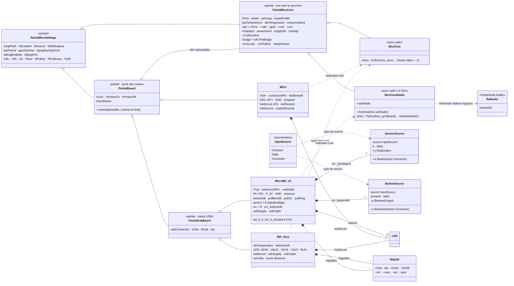
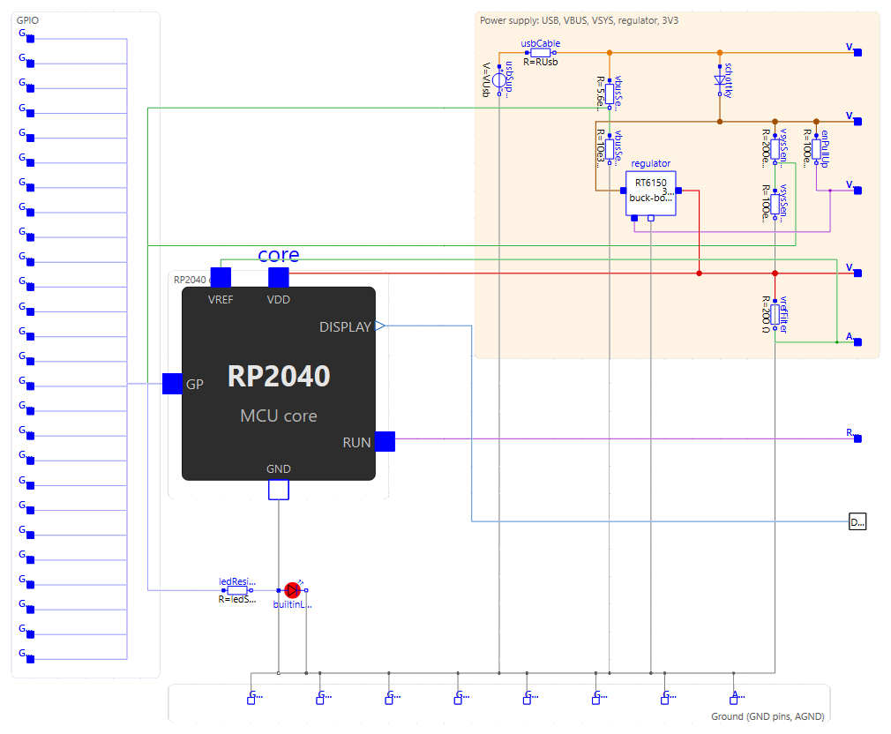
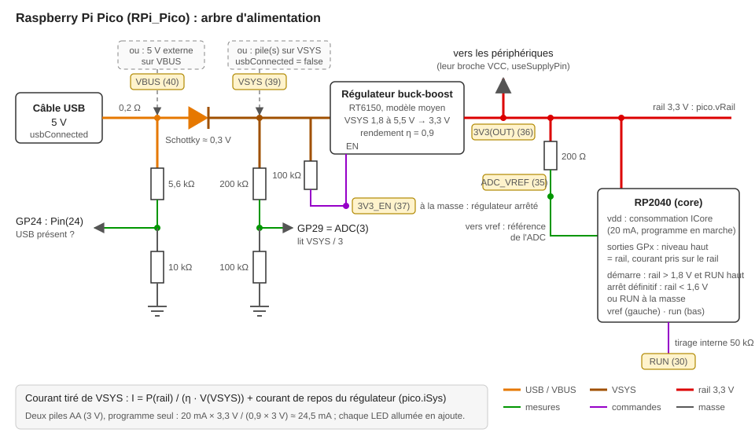

# Cœur, `MCU` et carte `RPi_Pico`

Depuis le 2026-10-04, le microcontrôleur programmable est un **composant** placé à l'intérieur des blocs posables — `MCU` (8 broches, alimentation idéale), `RPi_Pico` (réplique de la carte et de son alimentation) puis `MicroBit_v2` — et, depuis le refactoring du socle des cartes (2026-10-24), les trois cartes héritent de `Internal.PartialBoard` (contrat carte-cœur écrit une fois). Décision complète : « Carte Raspberry Pi Pico et alimentation » dans [`requirements.md`](https://gitlab.com/bdelaup/modelica_micropython/-/blob/main/requirements.md).

## Les classes

| Classe | Rôle |
|---|---|
| `Internal.PartialMcuSettings` | Paramètres réglés par l'utilisateur (programme, flash, temps d'exécution, débogage, étages électriques), avec leurs onglets. Étendu par `MCU`, `RPi_Pico` **et** `McuCore` : chaque carte transmet tous ses paramètres au cœur par des modificateurs `final`. Ainsi, chaque paramètre n'est écrit qu'une fois |
| `Internal.PartialBoard` | Socle commun des trois cartes : étend `PartialMcuSettings`, porte `boardName`, `ICore`/`VPowerOn`/`VPowerOff` et le cœur `replaceable` avec le contrat carte-cœur (`final`) écrit une seule fois ; chaque carte redeclare le cœur et sa table de broches dans le modificateur de son `extends` |
| `Internal.PartialUsbBoard` | Socle des cartes USB (`RPi_Pico`, `MicroBit_v2`) : ajoute les paramètres `usbConnected`/`VUsb`/`RUsb`/`eta` ; les composants et le câblage restent dans chaque carte |
| `Internal.PartialMcuCore` | Le cœur sans sa synchro ni sa radio : `PyRuntime`, un `PinBridge` par broche, la mise sous tension. Connecteurs : `pin[nPins]`, `vdd`, `gnd`, `vref`, `run`, `Display0` |
| `Internal.McuCore` | `PartialMcuCore` + le grand `when` de synchro (`PyRuntime_sync`, réseau radio -1 : pas de radio). Placé dans `MCU` et `RPi_Pico` |
| `Internal.McuCoreRadio` | `PartialMcuCore` + le `when` de synchro et la radio 2,4 GHz (`useRadio`, port conditionnel `AntennaIn`, identifiant du réseau passé à `PyRuntime_sync`). Placé dans `MicroBit_v2` (redeclare) |
| `Internal.SensorSource` / `Internal.ButtonSource` | Blocs sources paramétrables (constante / table horaire / connecteur, énumération `Interfaces.InputSource`) : un par capteur et par bouton de la micro:bit |
| `Internal.PinBridge` | Étage électrique d'une broche, en équations : sortie push-pull par deux conductances (`1/ROut` de `vdd` vers la broche, ou de la broche vers `VOL`), tirages, fuite `GOff` |
| `MCU` | Le cœur + une `ConstantVoltage(VOH)` sur `vdd` et `vref` + la LED embarquée sur `pin[9]`. `run` reste en l'air (tirage interne) |
| `RPi_Pico` | Le cœur + l'arbre d'alimentation de la carte + la LED sur `pin[26]`. **Généré** par `tools/make_pico.py` : ne pas éditer `RPi_Pico.mo` à la main |
| `Internal.Rt6150` | Régulateur buck-boost, modèle moyen |
| `Internal.PartialSupplyPin` | `GND` + broche `VCC` facultative (`useSupplyPin`) des périphériques |

Les connecteurs restent dans la classe qui porte l'icône (`MCU`, `RPi_Pico`) : un placement hérité ne se modifie pas, et les deux icônes n'ont ni la même taille ni le même système de coordonnées. La liaison `Display0` passe du cœur à la carte par un `connect` de deux sorties (intérieure vers extérieure), sans équation d'alias.

## Diagramme des classes

L'héritage (`extends`) est la flèche pleine ; le losange `o--` est le **slot `replaceable`** ouvert par `PartialBoard` ; la flèche pointillée `redeclare` donne le **type effectif** choisi par chaque carte ; les liens pleins `*--` sont les composants internes. Le contrat carte-cœur (les ~25 modificateurs `final`) est écrit une seule fois dans `PartialBoard` ; la radio n'existe que dans la branche `McuCoreRadio` — décision « Refactoring du socle des cartes » de `requirements.md`.



## Table des broches

Le cœur reçoit sa table par ses paramètres `nPins`, `pinIds` (numéro GPIO de chaque broche), `pinCaps` (capacités), `boardProfile`, `hasTempSensor`. Il la transmet au constructeur `PyRuntime`, complétée par la pseudo-broche du capteur de température (identifiant 30) si `hasTempSensor`.

| Capacité | Valeur | Autorise |
|---|---|---|
| `PIN_CAP_DIGITAL` | 1 | `Pin`, `PWM` |
| `PIN_CAP_EXTERNAL` | 2 | `UART`, `I2C`, `I2CTarget` (broche reliée à un connecteur) |
| `PIN_CAP_ADC` | 4 | `ADC` |

- `MCU` : `{0, …, 7, 25}`, capacités `7` pour GP0-GP7 et `1` pour la LED.
- `RPi_Pico` : `{0, …, 29}` (`pin[i]` = GPIO `i−1`), `3` pour GP0-GP22, `1` pour GP23-GP25 (broches internes), `7` pour GP26-GP28, `5` pour GP29 (`VSYS/3`), puis le capteur (`4`).

Côté C (`pyruntime_core.h`) : `MAX_PINS = 32` dimensionne les tableaux du handle ; `num_pins`, `pin_id[]`, `pin_caps[]` y sont copiés par `PyRuntime_new`. `resolve_pin_index` parcourt la table, `require_pin(id, caps, quoi)` vérifie les capacités et compose le message d'erreur à partir de la table (« GPIO 30 not supported on this board (valid: 0-29) »). Les tableaux de `PyRuntime_sync` sont de taille libre côté Modelica (`[:]`) ; leur taille est passée au C et comparée à la table.

## Profil de carte dans le shim

`_native.board()` rend `boardProfile`. Le shim (`_PICO`) en déduit, pour la Pico seulement : la numérotation de l'ADC (`ADC(0..3)` = GP26-GP29, `ADC(4)` = pseudo-broche 30), le multiplexage UART/I2C du RP2040 et les broches par défaut du port `rp2` (`_PICO_UART`, `_PICO_I2C`, `_pico_pins`), et l'unicité du moteur UART et du maître I2C (`_pico_owner` : `UART(0)` ou `UART(1)`, un seul à la fois — tous deux arrivent sur l'identifiant natif 0). `SoftI2C` est une classe dérivée de `I2C` qui échappe au multiplexage. La native `adc_read` rend une **fraction** de la référence `adcRef` (entrée de `PyRuntime_sync`, tension de `vref`).

## Mise sous tension et perte d'alimentation

Dans le cœur : `supplyOk` (tension de `vdd` au-dessus de `VPowerOn`, hystérésis jusqu'à `VPowerOff`), `runHigh` (tension de `run`), `powerGood = supplyOk and runHigh`, passé à la synchro ; `change(powerGood)` est une condition du `when`. Les étages des broches lisent `pre(powerGood)` : haute impédance sans alimentation, et coupure de la boucle algébrique `vdd` → `powerGood` → charge des broches → `vdd`. D'où `powerGood(start = false, fixed = true)` : pendant l'initialisation seulement, les broches (toutes en entrée de toute façon) sont en haute impédance.

Côté C (`PyRuntime_sync`, `pyruntime_module.c`) :

- **Avant le démarrage** (`started` faux) : tant que `powerGood` est faux, la synchro publie un état « non alimenté » (`publish_unpowered`) sans donner la main au worker, qui attend son premier tour. Première synchro alimentée : `started`, `boot_time` = instant courant (origine de `ticks_ms()`/`ticks_us()`), puis le chemin habituel.
- **Perte** (`power_loss`) : avertissement daté, `halted` → `yield_until` lève `SystemExit` à chaque appel (comme `shutdown`), le programme se déroule, le worker se gare ; la synchro attend `script_done`, puis `powered_off` : broches en entrée, UART/I2C/cible/minuteurs arrêtés. Le sous-interpréteur reste en vie jusqu'à `PyRuntime_destroy` (la synchro peut encore lire son état). Pas de redémarrage.
- **Jamais alimenté** : le premier tour du worker sort aussi sur `shutdown` (`never_started`) : aucun programme, fin propre.

## Arbre d'alimentation de `RPi_Pico`

Visible dans le schéma interne de la carte (fils colorés par réseau dans `make_pico.py`, `NET_COLORS` ; zones de fond `ZONES`) :

{ width="700" }

Schéma de principe, dessiné à la main (`images/pico-alimentation.svg`) :



En texte :

```
USB 5 V ─ RUsb ─ VBUS ─ Schottky (0,3 V) ─ VSYS ─ Rt6150 ─ 3V3 ─ core.vdd ─ broches, ICore
                   │                         │      │EN        └─ 200 Ω ─ ADC_VREF ─ core.vref
              5,6 k/10 k → GP24     200 k/100 k   100 k vers VSYS (3V3_EN)
                                     → GP29 (VSYS/3)
```

`Rt6150` : sortie 3,3 V derrière 0,05 Ω tant que `en` > 1 V et `VSYS` au-dessus du seuil (1,8 V au démarrage, 1,7 V à l'arrêt) ; courant d'entrée `max(Pout, 0)/(eta·VSYS) + IQ`. Les courants lisent `pre(running)` (boucle tension d'entrée → marche → courant d'entrée avec une pile à résistance interne). Arrêté, la sortie est en haute impédance.

## Broche `VCC` des périphériques

`Internal.PartialSupplyPin` porte `GND`, `VCC if useSupplyPin`, un rail protégé `rail` (relié à `VCC`, ou à une `ConstantVoltage(VOH)` si `not useSupplyPin`), le courant de repos `IQ` (proportionnel sous 1 V, fuite de 1 nS) et `vRail`. Étendu par `PartialUartPins` (appareils série, `RadioModem`), `PartialI2cDevice` et `Hx711`, qui remplacent leur `VOH` par `vRail` (niveau haut de `TX`/`DOUT`, rail des tirages). Le HX711 borne son excitation à `VCC − VDropout` et tire le courant du pont de `VCC` par un miroir (`excitationLoad.i = -excitation.i`).
